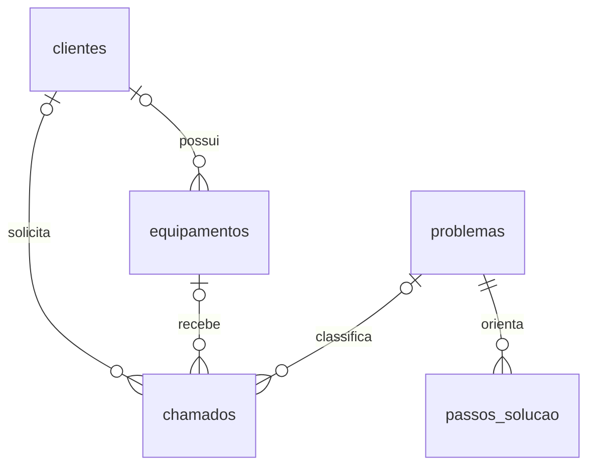

# Banco de dados — Orion Service

## Executar

Requisito: Node.js 24 ou superior. No terminal, na pasta do projeto:

```powershell
npm.cmd ci
npm.cmd run dev
```

Abra **http://localhost:5173**, preencha qualquer CPF e senha para entrar no login demonstrativo e clique em **Banco de dados** no menu (no celular, ícone ▤). A tela consulta diretamente o banco: permite escolher tabelas, pesquisar registros, conferir PK/FK, visualizar relacionamentos, atualizar a consulta e baixar o arquivo `.sqlite`. O login continua sendo uma simulação, sem autenticação real.

O comando inicia Vite e a API local juntos. Mantenha o terminal aberto. Ctrl+C encerra os servidores. A API usa a porta 3001 e o site a 5173. O banco é criado automaticamente no primeiro início; os próximos inícios preservam os registros.

## Arquivos para entregar

- `database/orion.sqlite`: banco SQLite pronto, com os registros iniciais e os chamados cadastrados depois.
- `database/schema.sql`: estrutura SQL reproduzível (tabelas, restrições, índices e visão).
- `database/consultas.sql`: exemplos SQL para a apresentação.
- `server/database.mjs`: importa os dados originais no primeiro uso e implementa as consultas e a gravação.
- `src/data/mock.js`: origem preservada dos registros iniciais; as telas agora leem pela API.

Também é possível abrir `orion.sqlite` em um visualizador compatível com SQLite, como DB Browser for SQLite, e usar as abas de estrutura, dados e execução SQL. Isso é opcional: o próprio site já permite apresentar o banco sem instalar outro programa. Feche o servidor antes de editar ou substituir o arquivo externamente.

## O que existe no banco

| Tabela | Registros iniciais | Função |
| --- | ---: | --- |
| clientes | 3 | Nome, CPF e cidade |
| equipamentos | 5 | Nome, modelo, série, status e detalhes disponíveis |
| problemas | 8 | Título, descrição e possível causa |
| passos_solucao | 4 | Instruções ordenadas do primeiro problema |
| chamados | 5 | Solicitações, data, status e vínculos quando conhecidos |

Há também a visão `resumo_chamados`, que usa `LEFT JOIN` para reunir chamados, clientes e equipamentos sem excluir chamados antigos sem vínculos.



Cada tabela tem uma chave primária `id`. CPF e número de série são únicos. As chaves estrangeiras preservam os relacionamentos e impedem apagar um registro referenciado. Restrições `CHECK` limitam status, prioridade e ordem das instruções. Os IDs dos novos chamados são gerados automaticamente. Datas são armazenadas como `AAAA-MM-DD`; a interface mostra `DD/MM/AAAA`.

## Fidelidade ao material original

Os dados são fictícios, copiados do protótipo React atual. Não foram criados clientes para justificar os números fixos 128 e 256 do painel antigo: os indicadores agora contam os registros do banco.

O material original não informa os proprietários dos equipamentos nem identifica cliente e série dos chamados antigos. Esses vínculos ficam `NULL`. O nome original do equipamento e o assunto do chamado são preservados. Os nomes alternados na antiga tabela administrativa eram calculados pelo índice da linha, sem vínculo cadastrado; não foram convertidos em relações reais. Os novos chamados exigem cliente, equipamento e problema existentes. Selecionar um cliente para um chamado não atribui automaticamente a propriedade do equipamento.

Apenas o primeiro equipamento tinha ano, fabricante e versão na tela de detalhes; os demais campos ficam `NULL`. O fabricante “John Deere” foi preservado do protótipo, sem validação externa. Apenas o primeiro problema tinha instruções de solução. As telas antigas HTML do CRM (`shared/crm.js`, clientes/negociações/atividades) continuam sendo um protótipo separado com localStorage e não foram migradas. A integração cobre o Orion Service em React, aberto pelo `index.html` atual.

## Roteiro de apresentação (5 minutos)

1. Explique: “Antes, os registros eram listas no JavaScript. Agora ficam em um banco relacional SQLite, consultado por uma API Node.js.”
2. Abra **Banco de dados** e mostre as cinco tabelas. Explique PK, FK e NULL com um exemplo da tela.
3. Mostre a relação entre problemas e passos de solução e entre chamados e equipamentos.
4. Abra **Meus chamados → Abrir chamado**, selecione cliente/equipamento/problema, informe descrição e prioridade e salve.
5. Volte a **Banco de dados → chamados**. Mostre o novo ID e as três chaves estrangeiras. Em `resumo_chamados`, mostre os nomes obtidos pelo JOIN.
6. Atualize a página ou reinicie os servidores. O chamado continua salvo no arquivo.
7. Mostre `schema.sql` e uma consulta de `consultas.sql`. Baixe o banco para entregar junto ao trabalho.

Arquitetura: **React → HTTP /api → Node.js → SQLite**. O navegador nunca abre diretamente o arquivo. A API valida os dados e usa parâmetros nas inserções. Esta versão é para demonstração local; não implementa autenticação nem isolamento de dados por usuário. As listagens mostram todos os registros acadêmicos.

## Verificação

```powershell
npm.cmd test
npm.cmd run build
```

Os testes usam um arquivo temporário, conferem os registros importados, restrições, criação de chamado e persistência após reabrir o banco. Para visualizar o build, mantenha `npm.cmd run server` em um terminal e execute `npm.cmd run preview` em outro. Hospedagem estática sozinha não executa a API SQLite.
